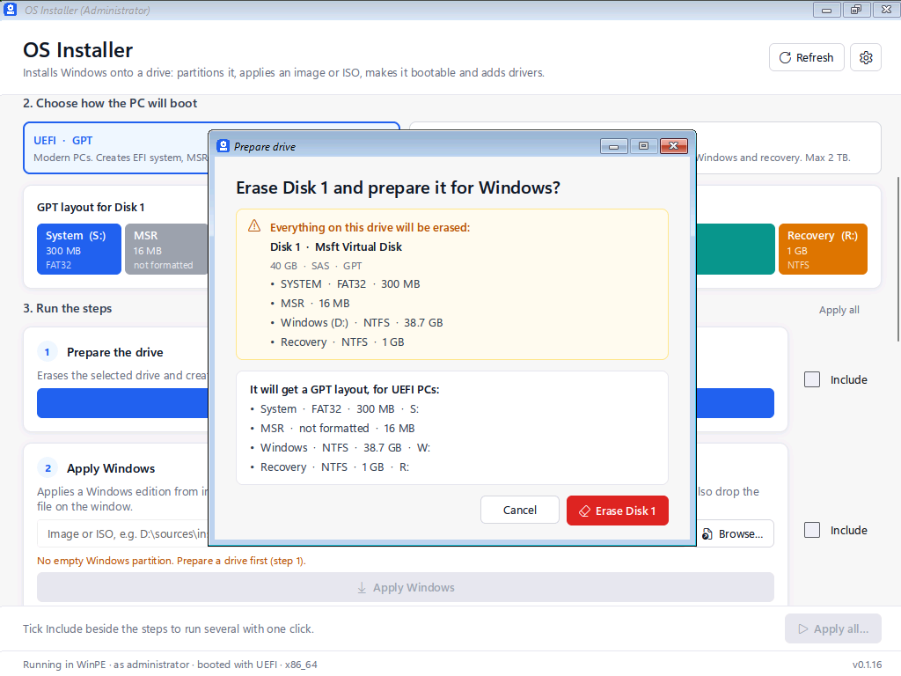
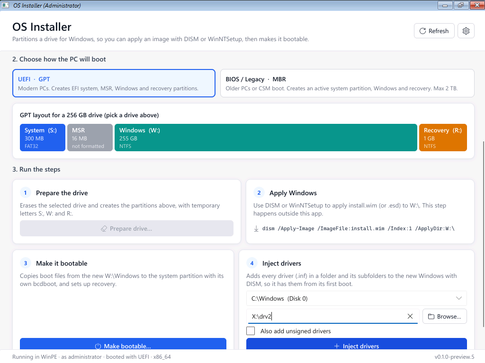
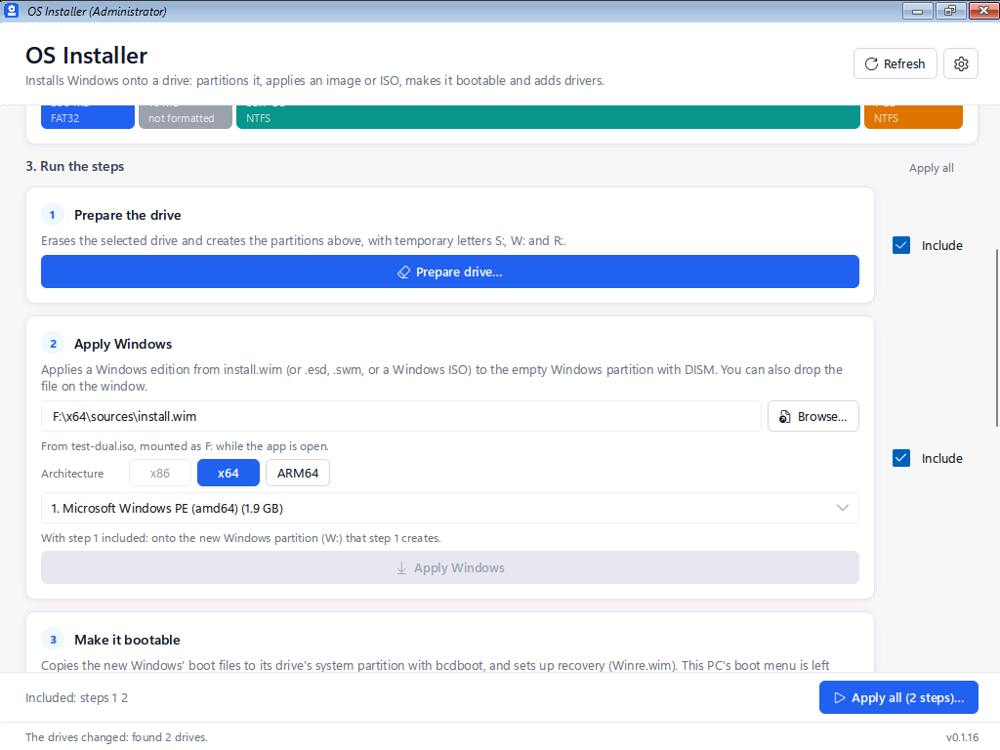
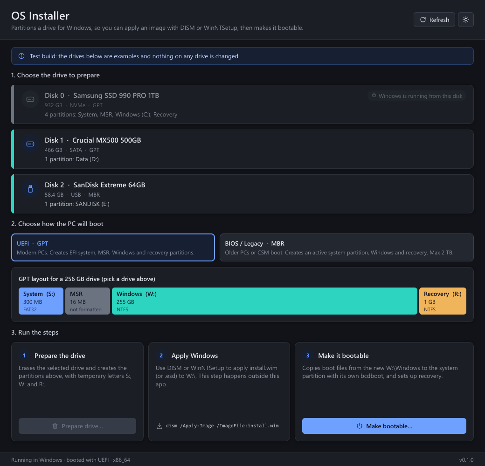
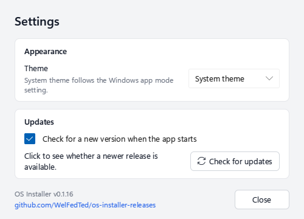

#  OS Installer

A small Windows tool that installs Windows onto a drive the way deployment technicians do it by hand: partition, apply the image, make it bootable, add drivers.

1. **Prepare the drive.** Pick a disk and how the PC will boot: UEFI (GPT) or BIOS / Legacy (MBR). OS Installer erases the disk and creates Microsoft's recommended partitions, with temporary drive letters.
2. **Apply Windows.** Choose a Windows **ISO** (or its `install.wim` / `install.esd`) and an edition; OS Installer applies it to `W:\` with DISM. You can drop the ISO on the window. (WinNTSetup or your own DISM command work too.)
3. **Make it bootable.** OS Installer copies the boot files from the new Windows to the system partition with that Windows' own `bcdboot`, and sets up the recovery partition.
4. **Inject drivers** (optional). OS Installer adds every driver (`.inf`) in a folder and its subfolders to the new Windows with DISM, so it has them from its first boot.

It is one small exe with a window and a command line, and it runs in full Windows and in **WinPE**, including a plain WinPE with no optional components added.


> **It erases disks.** All four steps work, in Windows and WinPE, and drives it prepared and made bootable start with UEFI and with BIOS in testing. Preparing a drive deletes everything on it, so try it on a spare drive or in a virtual machine first, and please report how it goes on real PCs.

Before anything is erased, OS Installer shows what is on the drive and what it will get, and asks:



It will not prepare the drive Windows is running from, the drive OS Installer itself is on, write-protected drives, Storage Spaces drives or, in WinPE, the drive with WinPE or Windows Setup on it (usually the USB stick you started from). Preparing needs administrator rights.



## USB drives

USB drives are listed and prepared like internal ones, and the list updates by itself when you plug a drive in or take it out. USB SSDs and hard drives behave like internal disks. Some USB flash drives (the ones that report removable media) may refuse the GPT partition table that UEFI needs; if so, OS Installer says so. USB support is new and hasn't been tested on many devices yet, so please report what works and what doesn't.

## Applying Windows from an ISO

Step 2 takes a Windows ISO as it is: OS Installer mounts it (read-only, only while the app is open), finds `sources\install.wim` or `install.esd` inside, and lists the editions to choose from. It only offers empty partitions to apply to, so it never mixes Windows into a drive with files on it. You can also browse to the image, type its path, or drop the ISO, image or a copied ISO folder onto the window.



## Injecting drivers

After applying Windows, step 4 (or `inject-drivers` on the command line) adds the drivers in a folder, such as the storage and network drivers for a new PC, to that Windows. It uses DISM, which WinPE and Windows include. Choose the Windows it found on the other drives, type or browse to the folder (subfolders are included), and optionally allow unsigned drivers.

## Download

Get **os-installer.exe** from the [releases page](https://github.com/WelFedTed/os-installer-releases/releases). It is a single file for 64-bit Windows 10, Windows 11 and WinPE, with nothing to install.

- In Windows, double-click it.
- In WinPE, copy it to your WinPE USB stick (or into the image) and run it from the command prompt, for example `D:\os-installer.exe`. The window fills the screen.

## Partition layouts

Following Microsoft's guidance for [UEFI/GPT](https://learn.microsoft.com/windows-hardware/manufacture/desktop/configure-uefigpt-based-hard-drive-partitions) and [BIOS/MBR](https://learn.microsoft.com/windows-hardware/manufacture/desktop/configure-biosmbr-based-hard-drive-partitions) drives:

| UEFI · GPT | Size | Format |
|---|---|---|
| System (EFI) `S:` | 300 MB | FAT32 |
| Microsoft Reserved (MSR) | 16 MB | |
| Windows `W:` | rest of the drive | NTFS |
| Recovery `R:` | 1 GB | NTFS (hidden) |

| BIOS · MBR | Size | Format |
|---|---|---|
| System `S:` (active) | 300 MB | NTFS |
| Windows `W:` | rest of the drive, up to 2 TB | NTFS |
| Recovery `R:` | 1 GB | NTFS (hidden) |

The drive letters are only for the imaging step; Windows assigns its own on first boot. If S:, W: or R: is already taken, OS Installer uses the next free letters from Z: down, and shows which.

## Command line

The same exe works from a command prompt, which suits scripts and WinPE:

```bat
os-installer list-disks
os-installer prepare --disk 1 --firmware uefi
os-installer prepare --disk 1 --firmware uefi --yes
os-installer list-windows
os-installer list-editions --image D:\Win11.iso
os-installer apply-image --image D:\Win11.iso --index 6 --windows W:\
os-installer make-bootable --windows W:\
os-installer inject-drivers --windows W:\ --drivers D:\Drivers
os-installer env
os-installer --help
```

- `list-disks` lists the drives with their partitions, letters and labels, and says which can't be prepared and why. Add `--json` for JSON.
- `prepare` shows what is on the drive and the layout it will get, and changes nothing (exit code 2). Only with `--yes` does it erase the drive and create the partitions; that needs an administrator command prompt (WinPE's always is). The disk numbers are the same as diskpart's.
- `list-editions` shows the editions in an ISO, `install.wim` or `install.esd`; `apply-image` applies one (by its index) to an empty partition and shows the percentage. Needs an administrator command prompt.
- `make-bootable` copies that Windows' boot files to its drive's system partition with its own `bcdboot` (UEFI for a GPT drive, BIOS for an MBR one) and sets up the recovery partition with its `Winre.wim` and `reagentc`. It works after a restart too, when the partitions have lost their letters. Needs an administrator command prompt.
- `list-windows` lists the Windows installations on other drives; `inject-drivers` adds every `.inf` in the folder and its subfolders to one of them (`--force-unsigned` adds unsigned drivers too). Needs an administrator command prompt.
- `env` says whether it is running in Windows or WinPE, whether it is running as administrator, and how the PC booted (UEFI or BIOS).
- `plan --firmware uefi --size-gb 476` shows the partitions for a drive of that size, without touching anything.

## Run as administrator

Partitioning a drive needs administrator rights. When the app is not running as administrator, the shield button at the top right restarts it through the Windows UAC prompt; answering No leaves it running as it was. The button is hidden once it is elevated, and in WinPE, which always runs as administrator.

## Light and dark

By default the window follows Windows' light or dark app mode, and switches when you change it. To keep it light or dark, open **Settings** with the cog button at the top right (or press F9) and choose a theme. The choice is remembered.





The screenshots are from WinPE, in a virtual machine with two virtual disks.

## Privacy

Everything happens on your PC. There is no telemetry and no account.

## Feedback

Found a bug or have an idea? [Open an issue](https://github.com/WelFedTed/os-installer-releases/issues).

---

OS Installer is free to download and use. It is not open source; the source code is not published. It is built with [Slint](https://slint.dev), and carries the Cascadia Mono font (SIL Open Font License). Copyright © 2026 WelFedTed. All rights reserved.
