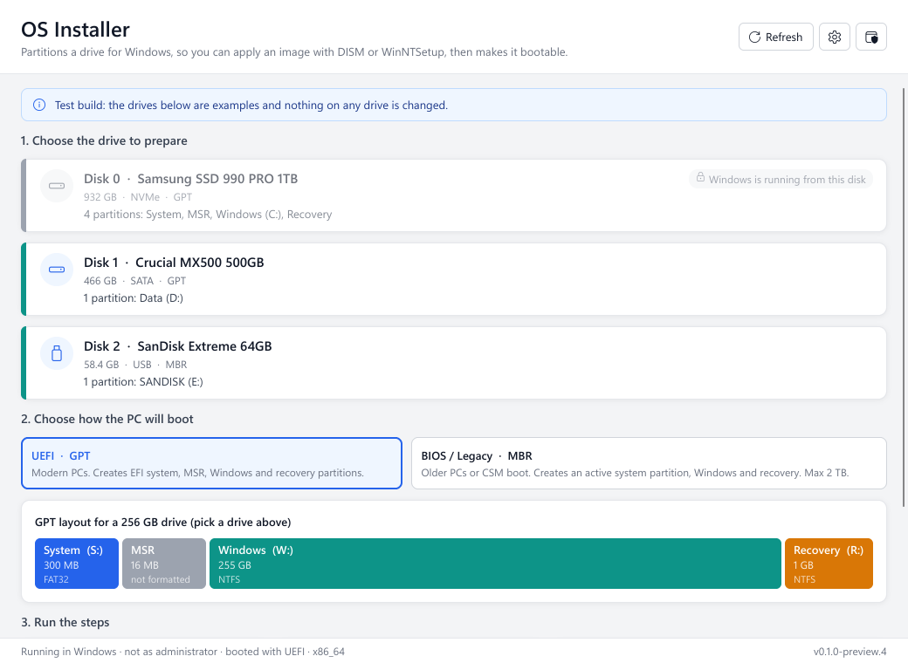
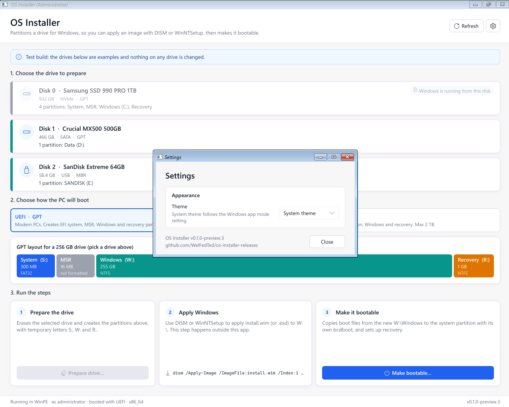

# OS Installer

A small Windows tool that gets a drive ready for Windows to be imaged onto by hand, then makes it bootable.

1. **Prepare the drive.** Pick a disk and how the PC will boot: UEFI (GPT) or BIOS / Legacy (MBR). OS Installer erases the disk and creates Microsoft's recommended partitions, with temporary drive letters.
2. **Apply Windows yourself** to `W:\` with DISM or WinNTSetup.
3. **Make it bootable.** OS Installer copies the boot files from the new Windows to the system partition with that Windows' own `bcdboot`, and sets up the recovery partition.

It is one small exe with a window and a command line, and it runs in full Windows and in **WinPE**, including a plain WinPE with no optional components added.



> **Preview.** The current release lets you try the window and the command line, in Windows and WinPE. It does **not** change any disk yet: the drives shown are examples. Partitioning and making drives bootable come in the next releases.

## Download

Get **os-installer.exe** from the [releases page](https://github.com/WelFedTed/os-installer-releases/releases). It is a single file for 64-bit Windows 10, Windows 11 and WinPE, with nothing to install. Previews are marked *Pre-release*.

- In Windows, double-click it.
- In WinPE, copy it to your WinPE USB stick (or into the image) and run it from the command prompt, for example `D:\os-installer.exe`. The window fills the screen.

## Partition layouts

Following Microsoft's guidance for [UEFI/GPT](https://learn.microsoft.com/windows-hardware/manufacture/desktop/configure-uefigpt-based-hard-drive-partitions) and [BIOS/MBR](https://learn.microsoft.com/windows-hardware/manufacture/desktop/configure-biosmbr-based-hard-drive-partitions) drives:

| UEFI · GPT | Size | Format |
|---|---|---|
| System (EFI) `S:` | 300 MB | FAT32 |
| Microsoft Reserved (MSR) | 16 MB | |
| Windows `W:` | rest of the drive | NTFS |
| Recovery `R:` | 1 GB | NTFS (hidden) |

| BIOS · MBR | Size | Format |
|---|---|---|
| System `S:` (active) | 300 MB | NTFS |
| Windows `W:` | rest of the drive, up to 2 TB | NTFS |
| Recovery `R:` | 1 GB | NTFS (hidden) |

The drive letters are only for the imaging step; Windows assigns its own on first boot.

## Command line

The same exe works from a command prompt, which suits scripts and WinPE:

```bat
os-installer env
os-installer plan --firmware uefi --size-gb 476
os-installer --help
```

`env` says whether it is running in Windows or WinPE, whether it is running as administrator, and how the PC booted (UEFI or BIOS). `plan` shows the partitions it would create on a drive of that size, without touching anything.

## Run as administrator

Partitioning a drive needs administrator rights. When the app is not running as administrator, the shield button at the top right restarts it through the Windows UAC prompt; answering No leaves it running as it was. The button is hidden once it is elevated, and in WinPE, which always runs as administrator.

## Light and dark

By default the window follows Windows' light or dark app mode, and switches when you change it. To keep it light or dark, open **Settings** with the cog button at the top right (or press F9) and choose a theme. The choice is remembered.


In WinPE, with Settings open:



## Privacy

Everything happens on your PC. There is no telemetry and no account.

## Feedback

Found a bug or have an idea? [Open an issue](https://github.com/WelFedTed/os-installer-releases/issues).

---

OS Installer is free to download and use. It is not open source; the source code is not published. It is built with [Slint](https://slint.dev), and carries the Cascadia Mono font (SIL Open Font License). Copyright © 2026 WelFedTed. All rights reserved.
